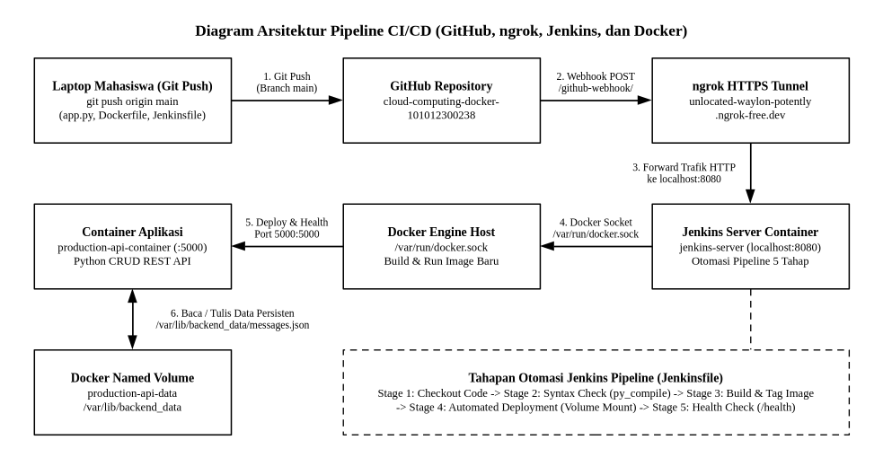
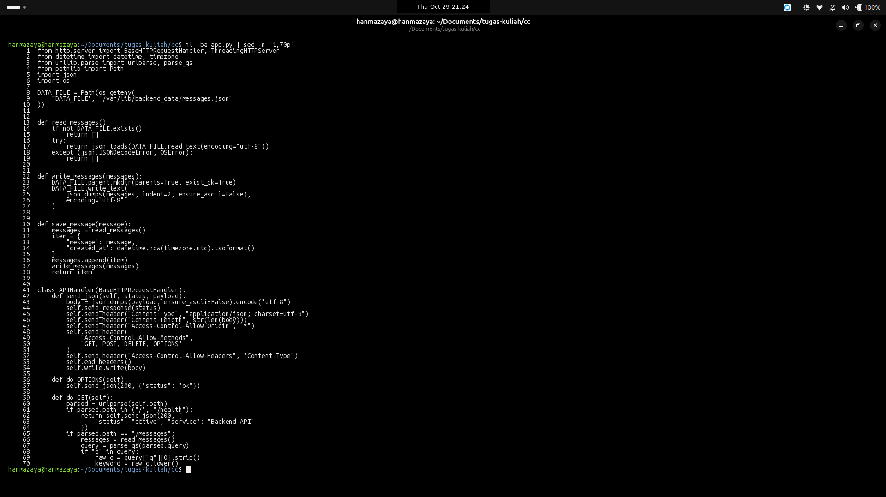
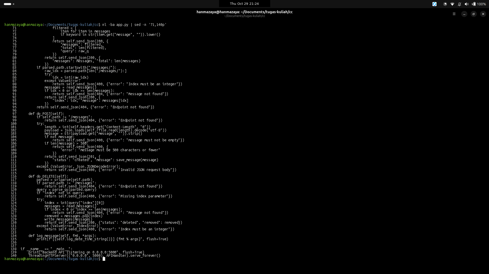
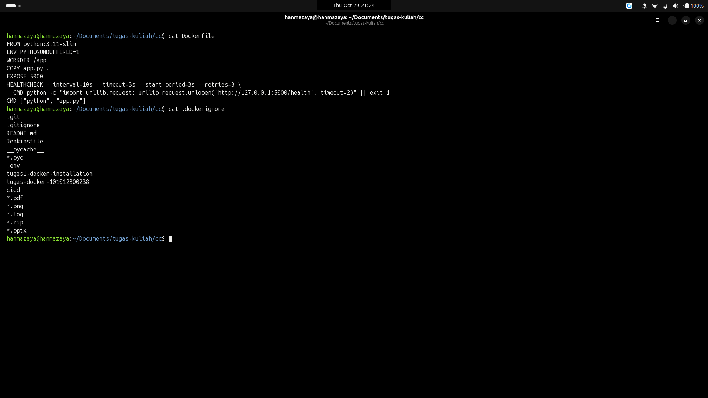
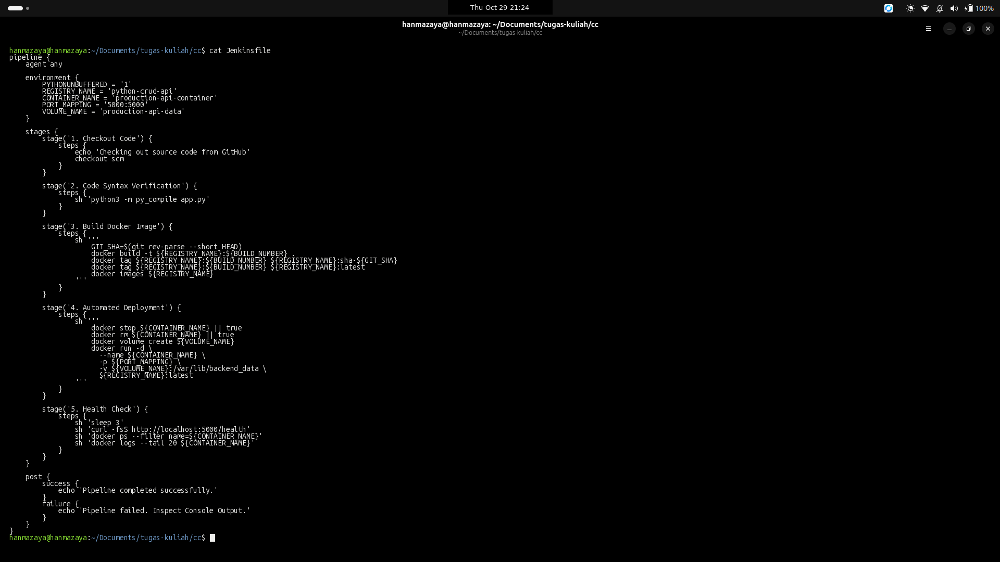
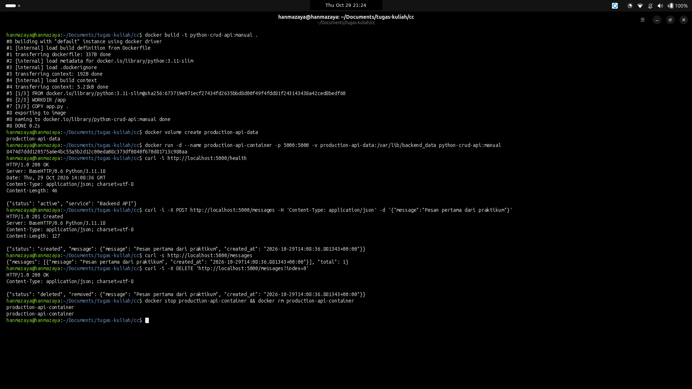
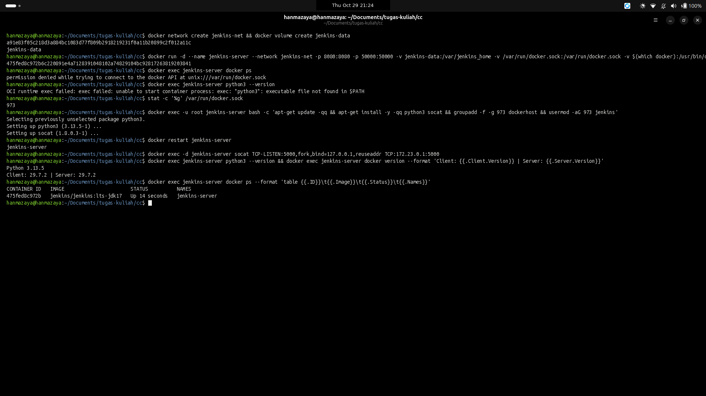
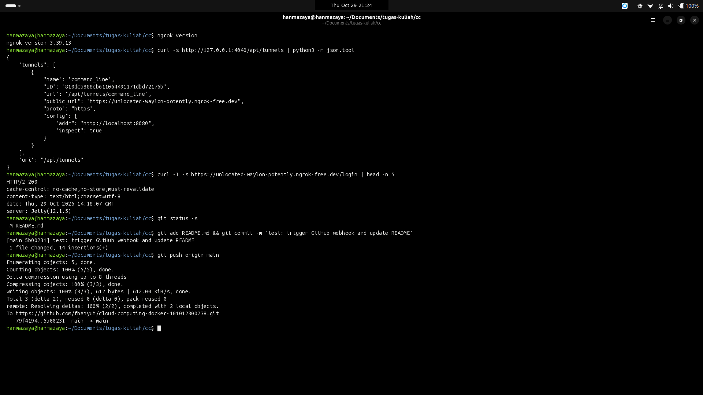
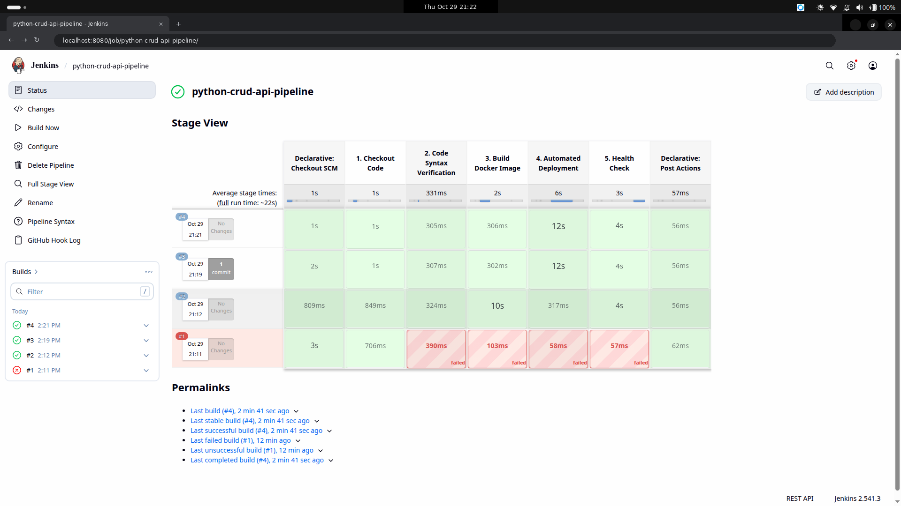
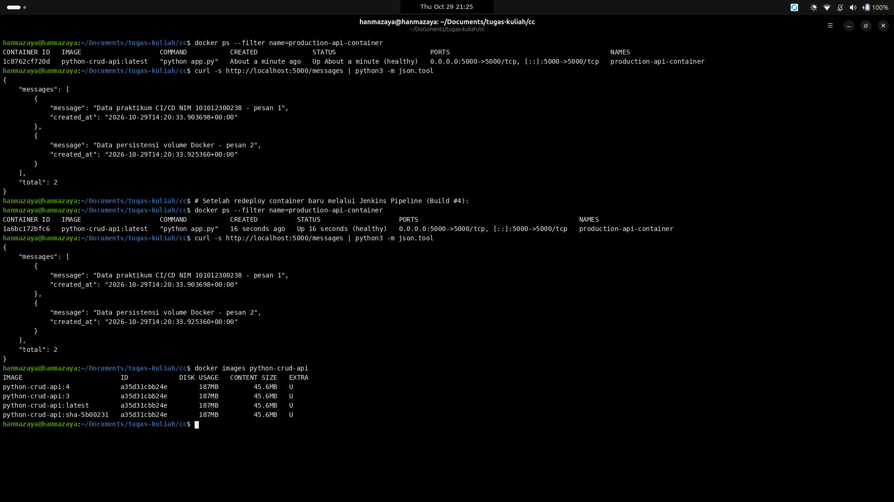

# Laporan Praktikum CI/CD Pipeline: Jenkins, GitHub, Docker, dan ngrok

Nama : Rafhan Mazaya Fathurrahman  
NIM : 101012300238  
Kelas : BS1TT-47-REG-GAB01  
Dosen : Cahyo Alhazim  
Repositori : https://github.com/fhanyuh/cloud-computing-docker-101012300238  

## Bagian 1. Arsitektur dan Persiapan Lingkungan

Pada praktikum ini dibuat alur kerja Continuous Integration dan Continuous Deployment (CI/CD) otomatis untuk layanan Python REST API. Kode sumber aplikasi disimpan pada repositori GitHub, kemudian setiap perubahan yang dikirim melalui perintah git push diteruskan oleh layanan tunnel ngrok ke server Jenkins lokal yang berjalan di dalam container Docker. Selanjutnya Jenkins menjalankan lima tahapan pipeline secara otomatis mulai dari pengambilan kode, pemeriksaan sintaks, pembuatan image Docker, deployment container baru, hingga pengujian endpoint health check, dengan penyimpanan data pesan menggunakan Docker named volume agar data tidak hilang saat container diperbarui.

| Komponen | Lokasi / Port | Fungsi pada Sistem CI/CD |
|---|---|---|
| GitHub Repository | cloud-computing-docker-101012300238 | Menyimpan kode sumber (app.py, Dockerfile, .dockerignore, Jenkinsfile) dan mengirim notifikasi webhook saat terjadi push |
| ngrok HTTPS Tunnel | https://unlocated-waylon-potently.ngrok-free.dev | Meneruskan request HTTP POST dari GitHub ke port 8080 milik Jenkins di mesin lokal |
| Jenkins Server Container | localhost:8080 (jenkins-server) | Menjalankan pipeline CI/CD lima tahap secara otomatis berdasarkan definisi pada Jenkinsfile |
| Python CRUD API | localhost:5000 (production-api-container) | Menjalankan aplikasi backend REST API untuk operasi tambah, baca, filter, detail, dan hapus pesan |
| Docker Named Volume | production-api-data | Menyimpan file /var/lib/backend_data/messages.json di host agar tetap aman saat container diganti |

## Bagian 2. Pembuatan Aplikasi Python REST API, Dockerfile, dan Jenkinsfile

Aplikasi backend dibuat menggunakan modul bawaan Python (http.server) tanpa framework tambahan agar ukuran image tetap ringan dan cepat saat dibuild. Selain fitur dasar CRUD dari modul praktikum, ditambahkan juga tiga pengembangan dari Tugas D, yaitu:

1. Endpoint detail pesan berdasarkan indeks (GET /messages/{index}) dan pencarian pesan berdasarkan kata kunci secara case-insensitive melalui parameter query (GET /messages?q={keyword}) pada file app.py.
2. Instruksi HEALTHCHECK di dalam Dockerfile untuk memantau status layanan secara berkala dari sisi Docker Engine.
3. Penandaan versi image menggunakan nomor build, tag latest, serta potongan commit SHA Git (sha-{GIT_SHA}) di dalam Jenkinsfile untuk memudahkan penelusuran versi kode dan proses rollback.

### 2.1 Isi File app.py

Berikut adalah tampilan kode sumber app.py bagian pertama (baris 1 sampai 70) yang mencakup fungsi pembacaan dan penyimpanan file JSON ke path /var/lib/backend_data/messages.json serta awal handler HTTP:

Berikut adalah lanjutan isi kode sumber app.py bagian kedua (baris 71 sampai 140) yang menangani filter query, pembacaan detail pesan berdasarkan indeks, penambahan pesan baru (POST), penghapusan pesan (DELETE), serta inisialisasi server pada port 5000:

### 2.2 Isi File Dockerfile dan .dockerignore

File Dockerfile menggunakan base image python:3.11-slim dan menambahkan pengecekan berkala melalui instruksi HEALTHCHECK ke endpoint /health. Sementara itu, file .dockerignore digunakan agar folder dokumentasi, laporan, dan file Git tidak ikut terkirim ke Docker daemon saat proses build berlangsung.

Perbedaan antara HEALTHCHECK pada Dockerfile dan health check menggunakan curl di Jenkins adalah:

1. Pengecekan curl pada Jenkins (Stage 5) hanya berjalan satu kali sesaat setelah container baru dijalankan untuk menentukan apakah eksekusi pipeline dinyatakan berhasil atau gagal.
2. Instruksi HEALTHCHECK pada Dockerfile dijalankan terus-menerus oleh Docker Engine setiap 10 detik selama container aktif, sehingga status kesehatan container (healthy atau unhealthy) selalu terlihat ketika menjalankan perintah docker ps.

### 2.3 Isi File Jenkinsfile

File Jenkinsfile mendefinisikan pipeline deklaratif dengan 5 tahap berurutan, yaitu Checkout Code, Code Syntax Verification, Build Docker Image (dengan tambahan tag commit SHA), Automated Deployment (menghentikan container lama, memasang volume production-api-data, dan menjalankan container baru), serta Health Check.

### 2.4 Pengujian Manual Aplikasi di Docker Sebelum Integrasi Jenkins

Sebelum diintegrasikan ke Jenkins, aplikasi diuji terlebih dahulu secara manual menggunakan perintah docker build, pembuatan volume production-api-data, menjalankan container production-api-container, dan menguji endpoint melalui curl. Setelah dipastikan berjalan normal, container dihentikan dan dihapus kembali tanpa menghapus volume datanya.

## Bagian 3. Konfigurasi Jenkins dan Kredensial GitHub PAT

Container jenkins-server dijalankan pada jaringan jembatan jenkins-net dengan memetakan port 8080 serta memasang socket Docker host (/var/run/docker.sock) dan binary Docker CLI agar pipeline di dalam Jenkins dapat menjalankan perintah build dan run container di mesin host.

Untuk keperluan autentikasi pengambilan kode dari GitHub, modul menganjurkan penggunaan Fine-grained Personal Access Token (PAT) dengan hak akses read-only pada bagian Contents dan Metadata. Pada pengerjaan di lingkungan praktikum ini, kredensial diisi menggunakan token dari sesi GitHub CLI lokal dan disimpan ke menu Manage Jenkins, Credentials, System, Global credentials dengan tipe Username with password dan ID github-pat-readonly. Token disimpan sebagai secret di Jenkins sehingga nilainya tidak pernah tertulis di dalam kode repositori maupun log build.

## Bagian 4. Kendala yang Ditemukan (Troubleshooting) dan Perbaikannya

Ketika menjalankan container jenkins-server dan mencoba eksekusi Build #1 untuk pertama kalinya, ditemukan beberapa kendala pada lingkungan container Jenkins:

1. Kendala pertama adalah pesan permission denied saat user jenkins di dalam container mengakses /var/run/docker.sock. Hal ini terjadi karena file socket Docker di host dimiliki oleh grup dengan GID 973, sedangkan user jenkins belum terdaftar di grup tersebut. Perbaikannya dilakukan dengan membuat grup ber-GID 973 di dalam container jenkins-server dan memasukkan user jenkins ke grup tersebut, lalu melakukan restart container.
2. Kendala kedua adalah gagalnya Build #1 pada Stage 2 dengan pesan python3: not found (exit code 127) karena image resmi jenkins/jenkins:lts-jdk17 hanya menyediakan runtime Java secara bawaan. Perbaikannya dilakukan dengan menginstal paket python3 di dalam container jenkins-server sebagai user root.
3. Penyesuaian ketiga dilakukan untuk akses health check ke alamat localhost:5000 dari dalam container jenkins-server. Karena jenkins-server berjalan di dalam jaringan container tersendiri, akses localhost:5000 di dalam container mengarah ke dirinya sendiri dan bukan ke port 5000 milik host. Untuk mengatasinya dipasang paket socat di dalam container jenkins-server guna meneruskan trafik lokal port 5000 ke alamat gateway Docker host (172.23.0.1:5000).
4. Kendala keempat sempat muncul saat percobaan pemicuan webhook pertama kali, di mana proses git fetch di dalam container sempat gagal melakukan resolusi nama domain github.com. Masalah ini diatasi dengan menambahkan pencatatan alamat IP github.com pada file /etc/hosts di dalam container jenkins-server, kemudian mengirim ulang (redeliver) event webhook dari halaman GitHub.

Seluruh proses pembuatan container jenkins-server, kemunculan pesan error awal, langkah perbaikan, hingga verifikasi akhir akses Python dan Docker di dalam container ditunjukkan pada tangkapan layar terminal berikut:

## Bagian 5. Konfigurasi Tunnel ngrok dan Pengujian GitHub Webhook

Agar GitHub dapat mengirim notifikasi push ke server Jenkins yang berjalan di komputer lokal, dijalankan program ngrok pada port 8080. Layanan ngrok memberikan alamat publik HTTPS yaitu https://unlocated-waylon-potently.ngrok-free.dev yang meneruskan trafik ke http://localhost:8080. Alamat tersebut kemudian didaftarkan pada menu Settings, Webhooks di repositori GitHub dengan path /github-webhook/, format payload application/json, dan pemicu pada event push. Pada konfigurasi job python-crud-api-pipeline di Jenkins, opsi GitHub hook trigger for GITScm polling juga diaktifkan.

Selanjutnya dilakukan perubahan pada file README.md, lalu dijalankan perintah git add, git commit, dan git push ke branch main dari terminal:

Sesaat setelah perintah git push selesai, GitHub mengirimkan request HTTP POST ke endpoint /github-webhook/ melalui tunnel ngrok dan Jenkins langsung menjalankan Build #3 secara otomatis tanpa menekan tombol Build Now. Hasil eksekusi seluruh 5 tahap pada tampilan Stage View Jenkins terlihat berhasil (hijau) seperti pada gambar berikut:

Pada halaman Console Output Build #3 terlihat keterangan Started by GitHub push by fhanyuh, proses pembuatan tag image menggunakan nomor build dan commit SHA (python-crud-api:sha-5b00231), proses deployment container baru, hingga hasil akhir Finished: SUCCESS:

Bukti pengiriman payload webhook dari GitHub yang diterima dengan kode status HTTP 200 OK juga tercatat pada halaman Recent Deliveries dan inspeksi trafik seperti berikut:

## Bagian 6. Pengujian Endpoint CRUD, Fitur Tambahan, dan Persistensi Data

### 6.1 Matriks Pengujian Endpoint REST API

Setelah container production-api-container berjalan dari hasil deployment otomatis Jenkins, dilakukan pengujian menyeluruh terhadap seluruh endpoint CRUD dasar maupun fitur tambahan Tugas D menggunakan perintah curl di terminal. Ringkasan hasil pengujiannya disajikan pada tabel berikut:

| Skenario Uji | Metode dan Endpoint | Status HTTP | Respons JSON |
|---|---|---|---|
| Health Check | GET /health | 200 OK | {"status": "active", "service": "Backend API"} |
| Baca Data Awal (Kosong) | GET /messages | 200 OK | {"messages": [], "total": 0} |
| Tambah Pesan Pertama | POST /messages | 201 Created | {"status": "created", "message": {"message": "Data praktikum CI/CD NIM 101012300238 - pesan 1", ...}} |
| Tambah Pesan Kedua | POST /messages | 201 Created | {"status": "created", "message": {"message": "Data persistensi volume Docker - pesan 2", ...}} |
| Validasi Pesan Kosong | POST /messages | 400 Bad Request | {"error": "message must not be empty"} |
| Detail Pesan per Indeks | GET /messages/0 | 200 OK | {"index": 0, "message": {"message": "Data praktikum CI/CD NIM 101012300238 - pesan 1", ...}} |
| Filter Kata Kunci (?q=) | GET /messages?q=persistensi | 200 OK | {"messages": [{"message": "Data persistensi volume Docker - pesan 2", ...}], "total": 1, "query": "persistensi"} |
| Hapus Pesan Valid | DELETE /messages?index=2 | 200 OK | {"status": "deleted", "removed": {"message": "Pesan sementara untuk uji delete", ...}} |
| Hapus Indeks Tidak Ada | DELETE /messages?index=999 | 404 Not Found | {"error": "Message not found"} |

Berikut adalah tangkapan layar terminal saat menjalankan seluruh pengujian matriks endpoint di atas:

### 6.2 Pengujian Persistensi Data Lintas Redeploy

Untuk membuktikan bahwa data pesan tetap tersimpan walaupun container lama dihentikan dan dihapus saat proses deployment baru, dilakukan pengujian perbandingan antara kondisi sebelum redeploy (Build #3) dan sesudah redeploy (Build #4):

1. Sebelum redeploy (Build #3), container production-api-container memiliki ID 1c8762cf720d dan menyimpan dua pesan di dalam file /var/lib/backend_data/messages.json.
2. Ketika pipeline Build #4 dijalankan, Stage 4 mengeksekusi perintah docker stop dan docker rm terhadap container lama, kemudian membuat container baru dari image terbaru dengan tetap memasang volume production-api-data ke direktori /var/lib/backend_data.
3. Sesudah redeploy selesai, container aktif berganti ID menjadi 1a6bc172bfc6 dengan status Up (healthy). Saat endpoint GET /messages dipanggil kembali, kedua pesan sebelumnya beserta waktu pembuatannya (created_at) masih tersimpan utuh.

Hal ini membuktikan perbedaan siklus hidup antara container dan Docker named volume. Lapisan penyimpanan internal container bersifat sementara dan langsung hilang ketika perintah docker rm dijalankan. Sebaliknya, Docker named volume (production-api-data) disimpan secara terpisah oleh Docker Engine di mesin host sehingga datanya tetap bertahan dan dapat langsung digunakan kembali oleh container baru.

## Bagian 7. Jawaban Pertanyaan Analisis

1. **Jelaskan urutan peristiwa dari git push hingga container baru berjalan.**  
   Saat perintah git push origin main dijalankan dari laptop, kode terbaru dikirim ke repositori GitHub. GitHub kemudian mendeteksi adanya event push dan mengirimkan request HTTP POST berisi informasi commit ke alamat webhook ngrok (https://unlocated-waylon-potently.ngrok-free.dev/github-webhook/). Layanan ngrok meneruskan paket tersebut ke server Jenkins lokal pada port 8080. Jenkins menerima pemicu tersebut dan otomatis memulai eksekusi job python-crud-api-pipeline. Di dalam pipeline, Jenkins mengambil kode terbaru dari GitHub menggunakan kredensial PAT (Stage 1), memeriksa sintaks file app.py menggunakan py_compile (Stage 2), lalu membangun image Docker baru serta memberikan tag nomor build, commit SHA, dan latest (Stage 3). Selanjutnya Jenkins menghentikan dan menghapus container lama, memastikan volume production-api-data tersedia, serta menjalankan container baru pada port 5000 dengan memasang volume tersebut (Stage 4). Terakhir, Jenkins menguji endpoint /health melalui curl untuk memastikan layanan baru sudah aktif dan merespons HTTP 200 (Stage 5).

2. **Apa perbedaan PAT, webhook secret, dan ngrok authtoken?**  
   Personal Access Token (PAT) adalah token autentikasi pengganti password akun GitHub yang dipakai oleh Jenkins ketika mengambil (checkout/fetch) kode sumber dari repositori. Webhook secret adalah kunci rahasia yang dipasang di sisi GitHub dan Jenkins untuk menandatangani payload webhook dengan algoritma HMAC agar Jenkins bisa memastikan bahwa request webhook benar-benar berasal dari GitHub. Sementara itu, ngrok authtoken adalah token identitas akun pengguna untuk menghubungkan aplikasi klien ngrok di komputer lokal dengan layanan server tunnel ngrok.

3. **Mengapa PAT read-only cukup untuk checkout source code, tetapi tidak cukup untuk push kembali ke repository?**  
   Karena proses checkout atau git fetch di Jenkins hanya membaca dan mengunduh kode serta riwayat commit dari GitHub tanpa mengubah isi repositori, sehingga izin baca (Contents: Read-only dan Metadata: Read-only) sudah memadai. Sebaliknya, perintah git push membutuhkan izin tulis (Read and write) karena melakukan penambahan objek commit atau perubahan referensi branch di server GitHub. Penggunaan izin read-only lebih aman karena meminimalkan risiko jika token pada server CI bocor.

4. **Apa risiko memasang Docker socket host (/var/run/docker.sock) ke container Jenkins?**  
   File /var/run/docker.sock merupakan jalur komunikasi langsung ke layanan Docker daemon di mesin host yang berjalan dengan hak akses root. Jika container Jenkins memiliki akses penuh ke socket tersebut, maka proses atau skrip di dalam Jenkins dapat menjalankan container baru dengan hak akses penuh (privileged) atau melakukan mount seluruh isi disk host ke dalam container. Akibatnya, siapa pun yang berhasil mengambil alih akses Jenkins pada dasarnya juga bisa mendapatkan akses setara root di komputer host.

5. **Mengapa URL ngrok yang berubah dapat memutus integrasi webhook?**  
   Pada akun gratis ngrok, setiap kali sesi perintah ngrok http 8080 dimatikan lalu dijalankan ulang, alamat domain acak yang diberikan akan ikut berubah. Karena pengaturan Payload URL pada menu Webhooks di GitHub tidak berubah secara otomatis, GitHub masih akan mengirim notifikasi push ke alamat domain ngrok yang lama. Akibatnya pengiriman webhook akan gagal sampai alamat URL yang baru diperbarui kembali di pengaturan GitHub.

6. **Mengapa data pada named volume bertahan setelah container dihapus?**  
   Karena siklus hidup named volume dikelola secara terpisah oleh Docker Engine di luar ruang penyimpanan internal container. Ketika perintah docker rm dijalankan, Docker hanya menghapus lapisan tulis sementara milik container yang bersangkutan, sedangkan isi direktori dari volume production-api-data pada sistem operasi host tetap disimpan sampai volume tersebut dihapus secara sengaja dengan perintah docker volume rm.

7. **Apa perbedaan CI dan CD pada pipeline ini?**  
   Bagian Continuous Integration (CI) berada pada Stage 1 sampai Stage 3 (Checkout Code, Code Syntax Verification, dan Build Docker Image), yang berfokus pada penggabungan perubahan kode dari repositori, pemeriksaan kesalahan sintaks Python, dan pembuktian bahwa aplikasi berhasil dibungkus menjadi image Docker yang siap pakai. Sedangkan bagian Continuous Deployment (CD) berada pada Stage 4 dan Stage 5 (Automated Deployment dan Health Check), yang bertugas menerapkan image terbaru tersebut menjadi container aktif di lingkungan produksi serta memastikan layanan dapat diakses dengan normal.

8. **Apa yang harus dilakukan jika tahap deploy sukses tetapi health check gagal?**  
   Tahap deploy yang berhasil hanya menandakan perintah docker run -d sukses membuat container di latar belakang, namun aplikasi Python di dalamnya bisa saja langsung berhenti karena terjadi error saat runtime. Langkah penanganannya adalah memeriksa status container dengan docker ps -a dan membaca pesan kesalahan pada log aplikasi menggunakan perintah docker logs production-api-container untuk mengetahui penyebab utamanya, misalnya kesalahan kode, port yang bentrok, atau masalah izin direktori. Sambil memperbaiki kode sumber, layanan dapat segera dipulihkan (rollback) dengan menjalankan container dari tag image versi sebelumnya yang sudah terbukti berjalan baik, seperti menggunakan tag nomor build lama atau tag commit SHA sebelumnya.
