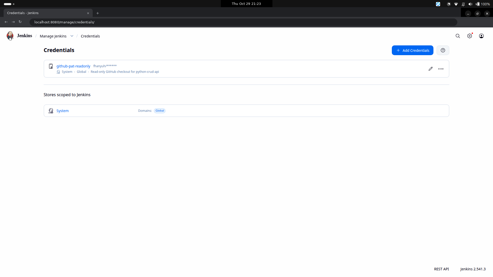
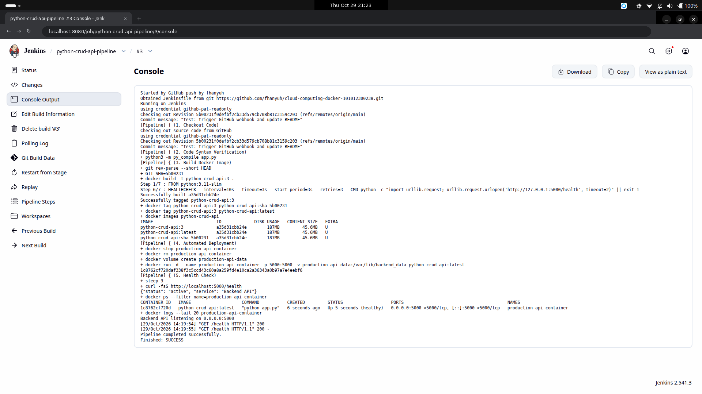
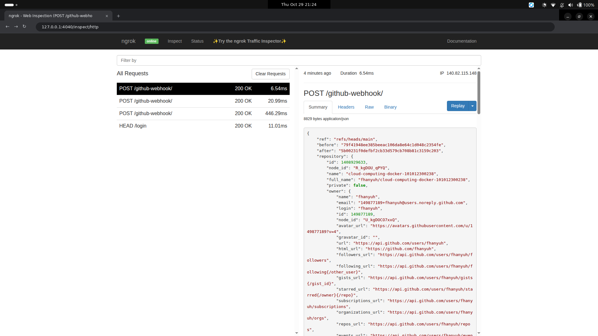
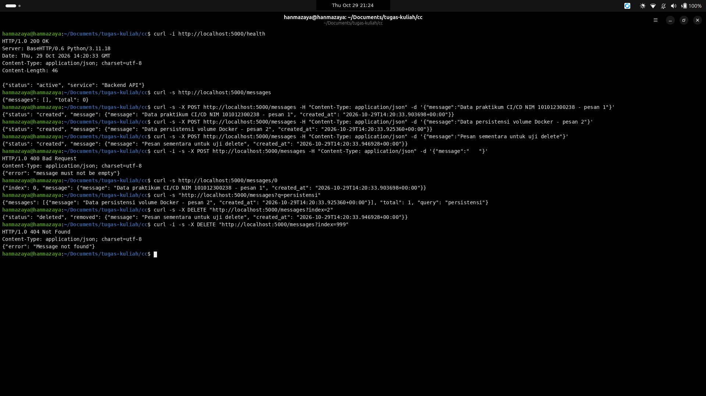

# Laporan Praktikum CI/CD Pipeline — Jenkins, GitHub, Docker, dan ngrok

Nama   : Rafhan Mazaya Fathurrahman  
NIM    : 101012300238  
Kelas  : BS1TT-47-REG-GAB01  
Dosen  : Cahyo Alhazim  
Repo   : https://github.com/fhanyuh/cloud-computing-docker-101012300238  

## Bagian 1 — Arsitektur dan Konfigurasi Lingkungan

Praktikum ini mengimplementasikan pipeline Continuous Integration dan Continuous Deployment (CI/CD) otomatis untuk layanan Python REST API menggunakan GitHub sebagai repositori kode sumber, ngrok sebagai penerus webhook HTTPS publik ke lingkungan lokal, Jenkins di dalam container Docker sebagai server otomasi, dan Docker Engine sebagai runtime deployment dengan penyimpanan persisten berbasis Docker named volume.

```text
Developer Laptop (git push)
        |
        v
GitHub Repository (fhanyuh/cloud-computing-docker-101012300238)
        |  Webhook HTTPS (POST /github-webhook/)
        v
ngrok Public Tunnel (https://unlocated-waylon-potently.ngrok-free.dev)
        |
        v
Jenkins Server (localhost:8080 - container jenkins-server)
        |  Docker Socket (/var/run/docker.sock)
        v
Docker Engine Host
        |
        +---> Container: production-api-container (localhost:5000)
        +---> Named Volume: production-api-data (/var/lib/backend_data)
```

| Komponen | Lokasi / Port | Peran pada Arsitektur CI/CD |
|---|---|---|
| GitHub Repository | `cloud-computing-docker-101012300238` | Menyimpan kode sumber (`app.py`, `Dockerfile`, `.dockerignore`, `Jenkinsfile`) dan mengirim event `push` melalui webhook |
| ngrok Tunnel | `https://unlocated-waylon-potently.ngrok-free.dev` | Meneruskan payload HTTP POST dari GitHub ke endpoint lokal Jenkins pada port `8080` |
| Jenkins UI & Server | `localhost:8080` (`jenkins-server`) | Menjalankan pipeline 5 tahap (checkout, verifikasi sintaks, build image, deploy container, health check) |
| Python CRUD API | `localhost:5000` (`production-api-container`) | Menyediakan layanan REST API (`/health`, `/messages`, `/messages/<id>`, `/messages?q=`) |
| Docker Named Volume | `production-api-data` | Menyimpan berkas `/var/lib/backend_data/messages.json` di luar siklus hidup container |

## Bagian 2 — Implementasi Aplikasi Python REST API, Dockerfile, dan Jenkinsfile (Tugas A & Tugas D)

Pada tahap ini dibangun aplikasi backend REST API tanpa framework eksternal (`http.server`), dilengkapi tiga pengembangan dari **Tugas D**:

1. **Endpoint Detail dan Filter Query (`app.py`)**: Penambahan endpoint `GET /messages/<index>` untuk mengambil pesan berdasarkan indeks serta parameter kueri `GET /messages?q=<keyword>` untuk memfilter pesan secara case-insensitive.
2. **Docker `HEALTHCHECK` (`Dockerfile`)**: Penambahan instruksi `HEALTHCHECK` di level container untuk memantau kesiapan `/health` secara berkala oleh Docker daemon.
3. **Tag Image Berbasis Commit SHA (`Jenkinsfile`)**: Selain tag `${BUILD_NUMBER}` dan `latest`, setiap build menandai image dengan `sha-${GIT_SHA}` (`git rev-parse --short HEAD`) guna memudahkan pelacakan versi komit dan rollback.

### 2.1 Kode Sumber `app.py`

```python
from http.server import BaseHTTPRequestHandler, ThreadingHTTPServer
from datetime import datetime, timezone
from urllib.parse import urlparse, parse_qs
from pathlib import Path
import json
import os

DATA_FILE = Path(os.getenv(
    "DATA_FILE", "/var/lib/backend_data/messages.json"
))


def read_messages():
    if not DATA_FILE.exists():
        return []
    try:
        return json.loads(DATA_FILE.read_text(encoding="utf-8"))
    except (json.JSONDecodeError, OSError):
        return []


def write_messages(messages):
    DATA_FILE.parent.mkdir(parents=True, exist_ok=True)
    DATA_FILE.write_text(
        json.dumps(messages, indent=2, ensure_ascii=False),
        encoding="utf-8"
    )


def save_message(message):
    messages = read_messages()
    item = {
        "message": message,
        "created_at": datetime.now(timezone.utc).isoformat()
    }
    messages.append(item)
    write_messages(messages)
    return item


class APIHandler(BaseHTTPRequestHandler):
    def send_json(self, status, payload):
        body = json.dumps(payload, ensure_ascii=False).encode("utf-8")
        self.send_response(status)
        self.send_header("Content-Type", "application/json; charset=utf-8")
        self.send_header("Content-Length", str(len(body)))
        self.send_header("Access-Control-Allow-Origin", "*")
        self.send_header(
            "Access-Control-Allow-Methods",
            "GET, POST, DELETE, OPTIONS"
        )
        self.send_header("Access-Control-Allow-Headers", "Content-Type")
        self.end_headers()
        self.wfile.write(body)

    def do_OPTIONS(self):
        self.send_json(200, {"status": "ok"})

    def do_GET(self):
        parsed = urlparse(self.path)
        if parsed.path in ("/", "/health"):
            return self.send_json(200, {
                "status": "active", "service": "Backend API"
            })
        if parsed.path == "/messages":
            messages = read_messages()
            query = parse_qs(parsed.query)
            if "q" in query:
                raw_q = query["q"][0].strip()
                keyword = raw_q.lower()
                filtered = [
                    item for item in messages
                    if keyword in str(item.get("message", "")).lower()
                ]
                return self.send_json(200, {
                    "messages": filtered,
                    "total": len(filtered),
                    "query": raw_q
                })
            return self.send_json(200, {
                "messages": messages, "total": len(messages)
            })
        if parsed.path.startswith("/messages/"):
            raw_idx = parsed.path[len("/messages/"):]
            try:
                idx = int(raw_idx)
            except ValueError:
                return self.send_json(400, {"error": "Index must be an integer"})
            messages = read_messages()
            if idx < 0 or idx >= len(messages):
                return self.send_json(404, {"error": "Message not found"})
            return self.send_json(200, {
                "index": idx, "message": messages[idx]
            })
        return self.send_json(404, {"error": "Endpoint not found"})

    def do_POST(self):
        if self.path != "/messages":
            return self.send_json(404, {"error": "Endpoint not found"})
        try:
            length = int(self.headers.get("Content-Length", "0"))
            payload = json.loads(self.rfile.read(length).decode("utf-8"))
            message = str(payload.get("message", "")).strip()
            if not message:
                return self.send_json(400, {"error": "message must not be empty"})
            if len(message) > 500:
                return self.send_json(400, {
                    "error": "message must be 500 characters or fewer"
                })
            return self.send_json(201, {
                "status": "created", "message": save_message(message)
            })
        except (ValueError, json.JSONDecodeError):
            return self.send_json(400, {"error": "Invalid JSON request body"})

    def do_DELETE(self):
        parsed = urlparse(self.path)
        if parsed.path != "/messages":
            return self.send_json(404, {"error": "Endpoint not found"})
        query = parse_qs(parsed.query)
        if "index" not in query:
            return self.send_json(400, {"error": "Missing index parameter"})
        try:
            index = int(query["index"][0])
            messages = read_messages()
            if index < 0 or index >= len(messages):
                return self.send_json(404, {"error": "Message not found"})
            removed = messages.pop(index)
            write_messages(messages)
            return self.send_json(200, {"status": "deleted", "removed": removed})
        except (ValueError, IndexError):
            return self.send_json(400, {"error": "Index must be an integer"})

    def log_message(self, fmt, *args):
        print(f"[{self.log_date_time_string()}] {fmt % args}", flush=True)


if __name__ == "__main__":
    print("Backend API listening on 0.0.0.0:5000", flush=True)
    ThreadingHTTPServer(("0.0.0.0", 5000), APIHandler).serve_forever()
```

### 2.2 `Dockerfile` dan `.dockerignore`

```dockerfile
FROM python:3.11-slim
ENV PYTHONUNBUFFERED=1
WORKDIR /app
COPY app.py .
EXPOSE 5000
HEALTHCHECK --interval=10s --timeout=3s --start-period=3s --retries=3 \
  CMD python -c "import urllib.request; urllib.request.urlopen('http://127.0.0.1:5000/health', timeout=2)" || exit 1
CMD ["python", "app.py"]
```

Perbandingan `HEALTHCHECK` Docker dengan health check `curl` dari Jenkins:

- **Health check `curl` di Jenkins (Stage 5)** bersifat satu kali (*one-shot verification*) sesaat setelah deployment untuk menentukan apakah eksekusi build pipeline dinyatakan `SUCCESS` atau `FAILURE`.
- **Instruksi `HEALTHCHECK` pada `Dockerfile`** dijalankan secara kontinu oleh Docker Engine setiap 10 detik selama container hidup, sehingga status kesehatan runtime (`healthy` atau `unhealthy`) dapat dipantau setiap saat melalui `docker ps` meskipun job Jenkins sudah selesai.

Isi berkas `.dockerignore`:

```text
.git
.gitignore
README.md
Jenkinsfile
__pycache__
*.pyc
.env
tugas1-docker-installation
tugas-docker-101012300238
cicd
*.pdf
*.png
*.log
*.zip
*.pptx
```

### 2.3 Definisi Pipeline-as-Code (`Jenkinsfile`)

```groovy
pipeline {
    agent any

    environment {
        PYTHONUNBUFFERED = '1'
        REGISTRY_NAME = 'python-crud-api'
        CONTAINER_NAME = 'production-api-container'
        PORT_MAPPING = '5000:5000'
        VOLUME_NAME = 'production-api-data'
    }

    stages {
        stage('1. Checkout Code') {
            steps {
                echo 'Checking out source code from GitHub'
                checkout scm
            }
        }

        stage('2. Code Syntax Verification') {
            steps {
                sh 'python3 -m py_compile app.py'
            }
        }

        stage('3. Build Docker Image') {
            steps {
                sh '''
                    GIT_SHA=$(git rev-parse --short HEAD)
                    docker build -t ${REGISTRY_NAME}:${BUILD_NUMBER} .
                    docker tag ${REGISTRY_NAME}:${BUILD_NUMBER} ${REGISTRY_NAME}:sha-${GIT_SHA}
                    docker tag ${REGISTRY_NAME}:${BUILD_NUMBER} ${REGISTRY_NAME}:latest
                    docker images ${REGISTRY_NAME}
                '''
            }
        }

        stage('4. Automated Deployment') {
            steps {
                sh '''
                    docker stop ${CONTAINER_NAME} || true
                    docker rm ${CONTAINER_NAME} || true
                    docker volume create ${VOLUME_NAME}
                    docker run -d \
                      --name ${CONTAINER_NAME} \
                      -p ${PORT_MAPPING} \
                      -v ${VOLUME_NAME}:/var/lib/backend_data \
                      ${REGISTRY_NAME}:latest
                '''
            }
        }

        stage('5. Health Check') {
            steps {
                sh 'sleep 3'
                sh 'curl -fsS http://localhost:5000/health'
                sh 'docker ps --filter name=${CONTAINER_NAME}'
                sh 'docker logs --tail 20 ${CONTAINER_NAME}'
            }
        }
    }

    post {
        success {
            echo 'Pipeline completed successfully.'
        }
        failure {
            echo 'Pipeline failed. Inspect Console Output.'
        }
    }
}
```

### 2.4 Verifikasi Manual Aplikasi di Docker Sebelum Integrasi Jenkins

```bash
docker build -t python-crud-api:manual .
docker volume create production-api-data
docker run -d --name production-api-container \
  -p 5000:5000 \
  -v production-api-data:/var/lib/backend_data \
  python-crud-api:manual
curl -i http://localhost:5000/health
```

Output pengujian manual (`cicd/logs/01-manual-docker-test.log` dan `cicd/logs/02-manual-crud-curl.log`):

```text
HTTP/1.0 200 OK
Server: BaseHTTP/0.6 Python/3.11.18
Content-Type: application/json; charset=utf-8
Content-Length: 46

{"status": "active", "service": "Backend API"}
```

Setelah pengujian manual selesai, container `production-api-container` dihentikan dan dihapus (`docker stop && docker rm`) tanpa menghapus volume `production-api-data`.

## Bagian 3 — Konfigurasi Jenkins di Docker dan Kredensial GitHub PAT

### 3.1 Menjalankan Container `jenkins-server`

```bash
docker network create jenkins-net
docker volume create jenkins-data
docker run -d \
  --name jenkins-server \
  --network jenkins-net \
  -p 8080:8080 -p 50000:50000 \
  -v jenkins-data:/var/jenkins_home \
  -v /var/run/docker.sock:/var/run/docker.sock \
  -v "$(which docker)":/usr/bin/docker \
  --restart unless-stopped \
  jenkins/jenkins:lts-jdk17
```

### 3.2 Konfigurasi GitHub Fine-Grained PAT dan Jenkins Credential

Modul menyarankan Fine-grained PAT dengan izin `Contents: Read-only` dan `Metadata: Read-only` khusus satu repositori. Pada praktikum ini, secret credential diisi dengan token hasil `gh auth token` dari sesi GitHub CLI yang sudah login, bukan Fine-grained PAT khusus, sehingga cakupan izinnya lebih luas daripada yang dianjurkan modul. Untuk penggunaan di luar lab, token ini sebaiknya diganti dengan Fine-grained PAT read-only lewat Jenkins Credentials (ID tetap `github-pat-readonly`). Nilai token tidak pernah ditulis ke repositori maupun log. Credential disimpan pada **Manage Jenkins -> Credentials -> System -> Global credentials** menggunakan jenis `Username with password`, Username `fhanyuh`, ID `github-pat-readonly`, dan deskripsi `Read-only GitHub checkout for python-crud-api`.



## Bagian 4 — Dokumentasi Troubleshooting Nyata dan Validasi Pipeline

Saat menjalankan **Build #1** pertama kali pada job `python-crud-api-pipeline` dan menguji akses Docker dari dalam `jenkins-server`, ditemukan dua kendala lingkungan pada container `jenkins-server` (`cicd/logs/03-troubleshooting-build1-failed.log`):

```text
=== 1. Pemeriksaan Awal Docker CLI & Socket di Container Jenkins ===
$ docker exec jenkins-server docker ps
permission denied while trying to connect to the docker API at unix:///var/run/docker.sock

=== 2. Potongan Console Output Jenkins Build #1 (Gagal) ===
[Pipeline] { (2. Code Syntax Verification)
[Pipeline] sh
+ python3 -m py_compile app.py
/var/jenkins_home/workspace/python-crud-api-pipeline@tmp/durable-5c052ac4/script.sh.copy: 1: python3: not found
...
ERROR: script returned exit code 127
Finished: FAILURE
```

### Analisis Penyebab dan Langkah Penyelesaian

1. **Masalah 1 (`python3: not found` pada Stage 2)**: Image resmi `jenkins/jenkins:lts-jdk17` berbasis Debian hanya menyertakan runtime Java secara bawaan. Solusi: memasang paket `python3` di dalam container `jenkins-server` menggunakan `docker exec -u root jenkins-server apt-get update && apt-get install -y python3 socat`.
2. **Masalah 2 (`permission denied` pada `/var/run/docker.sock`)**: Berkas `/var/run/docker.sock` pada host dimiliki oleh grup `docker` dengan GID `973`, sedangkan proses Jenkins berjalan sebagai user `jenkins` (UID `1000`). Solusi: menambahkan grup ber-GID `973` di dalam container dan memasukkan user `jenkins` ke grup tersebut (`groupadd -f -g 973 dockerhost && usermod -aG 973 jenkins`), lalu melakukan `docker restart jenkins-server`.
3. **Penyesuaian 3 (antisipasi akses `http://localhost:5000/health` dari dalam container `jenkins-server`)**: Bagian ini tidak tercatat sebagai kegagalan build karena relay sudah dipasang sebelum Build #2. Karena `jenkins-server` berada di jaringan bridge `jenkins-net`, alamat `localhost:5000` di dalam container mengarah ke loopback milik `jenkins-server` sendiri, bukan port `5000` di host. Solusi: menjalankan relay lokal `socat TCP-LISTEN:5000,fork,bind=127.0.0.1,reuseaddr TCP:172.23.0.1:5000` di dalam `jenkins-server` agar request `curl -fsS http://localhost:5000/health` diteruskan ke gateway host Docker tempat `production-api-container` mempublikasikan port `5000`.

Setelah perbaikan diterapkan, **Build #2** dijalankan dan seluruh 5 stage berhasil (`Finished: SUCCESS`, terekam pada `cicd/logs/04-jenkins-docker-verify.log` dan `cicd/logs/05-jenkins-build2-console.log`).

Satu kendala lagi muncul saat Build #3 pertama kali terpicu webhook (bagian 5.2): checkout gagal dengan `fatal: unable to access 'https://github.com/...': Could not resolve host: github.com` karena resolusi DNS di dalam `jenkins-server` sempat gagal. Solusi: menambahkan entri `github.com` ke `/etc/hosts` container (`docker exec -u root jenkins-server`). Catatan: relay `socat` dan entri `/etc/hosts` tidak persisten, jadi harus diulang jika container `jenkins-server` dibuat ulang.

## Bagian 5 — Tunneling ngrok dan Otomasi GitHub Webhook (Tugas B)

### 5.1 Konfigurasi Tunnel ngrok dan GitHub Webhook

Tunnel HTTP dibuka pada port `8080` menggunakan `ngrok http 8080` dan menghasilkan alamat HTTPS publik `https://unlocated-waylon-potently.ngrok-free.dev` yang meneruskan trafik ke `http://localhost:8080`. Selanjutnya pada pengaturan **Settings -> Webhooks** di repositori GitHub, didaftarkan webhook dengan konfigurasi:

- **Payload URL**: `https://unlocated-waylon-potently.ngrok-free.dev/github-webhook/`
- **Content type**: `application/json`
- **Events**: `Just the push event` (`["push"]`)
- **Active**: `true`

Pada konfigurasi job `python-crud-api-pipeline`, opsi **GitHub hook trigger for GITScm polling** diaktifkan.

### 5.2 Pengujian Pemicuan Build Otomatis melalui `git push`

Dilakukan pembaruan dokumentasi pada `README.md`, lalu dijalankan komit dan push ke branch `main`:

```bash
git add README.md
git commit -m "test: trigger GitHub webhook and update README"
git push origin main
```

GitHub mengirimkan event `push` ke endpoint `/github-webhook/` melalui ngrok dengan kode respons `200 OK` (`cicd/logs/08-github-webhook-delivery.log`), dan Jenkins secara otomatis menjalankan **Build #3** tanpa menekan tombol `Build Now` (`Started by GitHub push by fhanyuh`).

```text
Started by GitHub push by fhanyuh
Obtained Jenkinsfile from git https://github.com/fhanyuh/cloud-computing-docker-101012300238.git
...
Checking out Revision 5b00231f0defbf2cb33d579cb708b81c3159c203 (refs/remotes/origin/main)
Commit message: "test: trigger GitHub webhook and update README"
[Pipeline] { (2. Code Syntax Verification)
+ python3 -m py_compile app.py
[Pipeline] { (3. Build Docker Image)
+ git rev-parse --short HEAD
+ GIT_SHA=5b00231
+ docker build -t python-crud-api:3 .
Successfully built a35d31cbb24e
Successfully tagged python-crud-api:3
+ docker tag python-crud-api:3 python-crud-api:sha-5b00231
+ docker tag python-crud-api:3 python-crud-api:latest
[Pipeline] { (4. Automated Deployment)
+ docker run -d --name production-api-container -p 5000:5000 -v production-api-data:/var/lib/backend_data python-crud-api:latest
1c8762cf720daf338f3c5ccd43c60a8a259fd4e10ca2a36343a0b97a7e4eebf6
[Pipeline] { (5. Health Check)
+ curl -fsS http://localhost:5000/health
{"status": "active", "service": "Backend API"}
Pipeline completed successfully.
Finished: SUCCESS
```

Catatan jujur: build otomatis pertama gagal karena masalah DNS di atas (log aslinya tidak disimpan). Setelah DNS diperbaiki, record build gagal tersebut dihapus dan delivery `push` yang sama dikirim ulang dari GitHub (Redeliver pada Recent Deliveries, `redelivery: true`, status `200`), sehingga Build #3 yang tersimpan pada `cicd/logs/07-jenkins-build3-webhook-console.log` terpicu webhook GitHub, bukan tombol `Build Now`.

### Screenshot 1 — Halaman Jenkins Pipeline & Stage View


### Screenshot 2 — Console Output Build #3 (Terpicu Otomatis oleh GitHub Push)



### Screenshot 3 — Trafik Delivery GitHub Webhook (`POST /github-webhook/ 200 OK`)



## Bagian 6 — Pengujian Matriks Endpoint, Fitur Tugas D, dan Persistensi Data (Tugas C & Tugas D)

### 6.1 Matriks Pengujian Endpoint REST API

Seluruh skenario uji pada Bagian 10.1 modul beserta endpoint tambahan Tugas D diuji terhadap container `production-api-container` (`cicd/logs/09-endpoint-matrix-test.log`):

| Kasus Uji | Perintah / Request | Status HTTP | Respons JSON Aktual |
|---|---|---|---|
| Health Check | `GET /health` | `200 OK` | `{"status": "active", "service": "Backend API"}` |
| Read Kosong | `GET /messages` | `200 OK` | `{"messages": [], "total": 0}` |
| Create Pesan 1 | `POST /messages` (`"Data praktikum CI/CD NIM 101012300238 - pesan 1"`) | `201 Created` | `{"status": "created", "message": {"message": "...", "created_at": "2026-10-29T14:20:33.903698+00:00"}}` |
| Create Pesan 2 | `POST /messages` (`"Data persistensi volume Docker - pesan 2"`) | `201 Created` | `{"status": "created", "message": {"message": "...", "created_at": "2026-10-29T14:20:33.925360+00:00"}}` |
| Input Kosong | `POST /messages` (`{"message": "   "}`) | `400 Bad Request` | `{"error": "message must not be empty"}` |
| Detail per Indeks (Tugas D) | `GET /messages/0` | `200 OK` | `{"index": 0, "message": {"message": "Data praktikum CI/CD NIM 101012300238 - pesan 1", ...}}` |
| Filter Query (Tugas D) | `GET /messages?q=persistensi` | `200 OK` | `{"messages": [{"message": "Data persistensi volume Docker - pesan 2", ...}], "total": 1, "query": "persistensi"}` |
| Delete Valid | `DELETE /messages?index=2` | `200 OK` | `{"status": "deleted", "removed": {"message": "Pesan sementara untuk uji delete", ...}}` |
| Delete Indeks Tidak Ada | `DELETE /messages?index=999` | `404 Not Found` | `{"error": "Message not found"}` |

### Screenshot 4 — Pengujian Matriks Endpoint dan Fitur Tugas D di Terminal



### 6.2 Pembuktian Persistensi Data Lintas Redeploy (Tugas C)

Untuk membuktikan bahwa data tidak hilang ketika container lama dihentikan, dihapus, dan diganti oleh container baru, dilakukan pengujian lintas deployment dari **Build #3** ke **Build #4** (`cicd/logs/10-persistence-proof.log`):

1. **Sebelum Redeploy (Build #3)**: Container aktif memiliki ID `1c8762cf720d` dan menyimpan 2 pesan pada `/var/lib/backend_data/messages.json` dengan timestamp `2026-10-29T14:20:33.903698+00:00` dan `2026-10-29T14:20:33.925360+00:00`.
2. **Eksekusi Redeploy (Build #4)**: Pipeline Jenkins mengeksekusi `docker stop production-api-container`, `docker rm production-api-container`, dan menjalankan container baru dengan opsi `-v production-api-data:/var/lib/backend_data`.
3. **Sesudah Redeploy (Build #4)**: Container baru berjalan dengan ID berbeda (`1a6bc172bfc6`, berstatus `Up (healthy)`), dan pemanggilan `GET /messages` tetap mengembalikan kedua pesan beserta timestamp asli tanpa kehilangan data.

**Perbedaan Lifecycle Container dan Docker Named Volume**:

- **Container** memiliki *writable layer* yang bersifat *ephemeral* (sementara) dan terikat langsung pada siklus hidup container. Ketika `docker rm` dijalankan oleh pipeline saat redeploy, seluruh lapisan tulis milik container lama ikut terhapus.
- **Docker Named Volume (`production-api-data`)** dikelola secara terpisah oleh Docker Engine pada direktori host (`/var/lib/docker/volumes/production-api-data/_data`) dan tidak bergantung pada siklus hidup container mana pun. Saat container lama dihapus dan container baru dipasang (*mount*) ke volume yang sama pada `/var/lib/backend_data`, berkas `messages.json` tetap utuh dan langsung terbaca oleh container baru.

### Screenshot 5 — Bukti Persistensi Data Lintas Redeploy dan Tag Image SHA


## Bagian 7 — Jawaban Pertanyaan Analisis

1. **Jelaskan urutan peristiwa dari `git push` hingga container baru berjalan.**
    - Pengembang menjalankan `git push origin main` dari laptop ke repositori GitHub.
    - GitHub mendeteksi event `push` dan mengirimkan request HTTP POST berisi payload JSON ke URL webhook publik ngrok (`https://unlocated-waylon-potently.ngrok-free.dev/github-webhook/`).
    - Agen ngrok meneruskan request tersebut ke server lokal Jenkins pada `http://localhost:8080/github-webhook/`.
    - Plugin GitHub pada Jenkins menerima notifikasi, mencocokkan repositori dengan job `python-crud-api-pipeline` yang mengaktifkan *GitHub hook trigger for GITScm polling*, lalu memicu build baru secara otomatis.
    - Jenkins melakukan checkout `Jenkinsfile` dan kode sumber terbaru dari branch `main` menggunakan kredensial `github-pat-readonly` (Stage 1), memvalidasi sintaks Python dengan `python3 -m py_compile app.py` (Stage 2), serta membangun image Docker baru dan memberi tag `${BUILD_NUMBER}`, `sha-${GIT_SHA}`, dan `latest` (Stage 3).
    - Pada Stage 4, Jenkins menghentikan dan menghapus container lama (`production-api-container`), memastikan volume `production-api-data` tersedia, lalu menjalankan container baru dari image hasil build dengan memetakan port `5000:5000` dan memasang volume `production-api-data:/var/lib/backend_data`.
    - Pada Stage 5, Jenkins menunggu 3 detik lalu memanggil `curl -fsS http://localhost:5000/health` untuk memastikan layanan merespons HTTP 200 sebelum menandai pipeline `SUCCESS`.

2. **Apa perbedaan PAT, webhook secret, dan ngrok authtoken?**
    - **GitHub Personal Access Token (PAT)**: Kredensial autentikasi (pengganti password Git) yang digunakan oleh Jenkins saat menarik (*checkout/fetch*) kode sumber dari repositori GitHub melalui HTTPS.
    - **Webhook Secret**: Kunci rahasia bersama (*shared secret*) antara GitHub dan Jenkins untuk menandatangani payload webhook menggunakan HMAC (`X-Hub-Signature-256`), sehingga Jenkins dapat memverifikasi bahwa payload HTTP POST benar-benar berasal dari GitHub dan bukan dari pihak ketiga.
    - **ngrok Authtoken**: Token autentikasi akun untuk mengidentifikasi agen CLI ngrok ke layanan cloud ngrok saat membuat tunnel publik.

3. **Mengapa PAT read-only cukup untuk checkout source code, tetapi tidak cukup untuk push kembali ke repository?**
    - Proses *checkout* (`git fetch` / `git clone`) hanya membaca objek Git dan metadata dari repositori, sehingga izin `Contents: Read-only` dan `Metadata: Read-only` sudah mencukupi. Sebaliknya, operasi `git push` atau pembuatan tag/release mengubah isi repositori di sisi server GitHub sehingga memerlukan izin tulis (`Contents: Read and write`). Memberikan akses read-only ke Jenkins membatasi dampak jika kredensial CI bocor.

4. **Apa risiko memasang Docker socket host (`/var/run/docker.sock`) ke container Jenkins?**
    - Socket `/var/run/docker.sock` memberikan akses penuh ke API Docker daemon pada mesin host yang berjalan dengan hak akses `root`. Siapa pun yang dapat menjalankan job atau skrip di dalam container Jenkins dapat membuat container baru dengan opsi `--privileged` atau melakukan *bind-mount* direktori root host (`-v /:/host`), yang setara dengan memperoleh akses `root` penuh atas sistem operasi host. Oleh karena itu pola ini hanya layak untuk lingkungan lab tunggal yang terpercaya.

5. **Mengapa URL ngrok yang berubah dapat memutus integrasi webhook?**
    - Pada paket gratis ngrok, setiap kali proses agen `ngrok http 8080` dihentikan dan dijalankan ulang, ngrok memberikan subdomain acak yang baru. Karena konfigurasi Payload URL pada GitHub Webhook bersifat statis, GitHub akan tetap mengirim event `push` ke domain ngrok lama yang sudah tidak aktif sehingga pengiriman webhook gagal hingga Payload URL diperbarui di pengaturan GitHub.

6. **Mengapa data pada named volume bertahan setelah container dihapus?**
    - Karena data di dalam named volume (`production-api-data`) disimpan di direktori khusus pada filesystem host (`/var/lib/docker/volumes/production-api-data/_data`) yang terpisah dari *union filesystem* container. Perintah `docker rm` hanya menghapus lapisan tulis milik container, sedangkan named volume tetap dipertahankan oleh Docker Engine sampai dihapus secara eksplisit menggunakan `docker volume rm`.

7. **Apa perbedaan CI dan CD pada pipeline ini?**
    - **Continuous Integration (CI)** mencakup **Stage 1 hingga Stage 3** (`Checkout Code`, `Code Syntax Verification`, dan `Build Docker Image`), yaitu proses mengintegrasikan perubahan kode dari GitHub, menguji validitas sintaks program, dan memastikan aplikasi dapat dikemas menjadi artefak image Docker yang konsisten.
    - **Continuous Deployment (CD)** mencakup **Stage 4 dan Stage 5** (`Automated Deployment` dan `Health Check`), yaitu proses memperbarui container produksi secara otomatis menggunakan image hasil build dan memverifikasi bahwa layanan hidup serta siap melayani trafik di port `5000`.

8. **Apa yang harus dilakukan jika tahap deploy sukses tetapi health check gagal?**
    - Perintah `docker run -d` pada tahap deploy hanya memastikan proses container berhasil dibuat di background, tetapi belum menjamin aplikasi di dalamnya berhasil mengikat port atau bebas dari *runtime exception*. Jika Stage 5 (`Health Check`) gagal, langkah yang harus dilakukan adalah:
        1. Memeriksa status container (`docker ps -a --filter name=production-api-container`) untuk melihat apakah container keluar (*Exited*) atau masih berjalan.
        2. Memeriksa log aplikasi (`docker logs production-api-container`) untuk menemukan penyebab kegagalan seperti error inisialisasi Python, kesalahan path volume, atau konflik port.
        3. Melakukan *rollback* ke image versi stabil sebelumnya menggunakan tag nomor build atau commit SHA sebelumnya (misalnya `docker run ... python-crud-api:sha-79f4194`) agar layanan kembali aktif sembari memperbaiki bug pada kode sumber.
